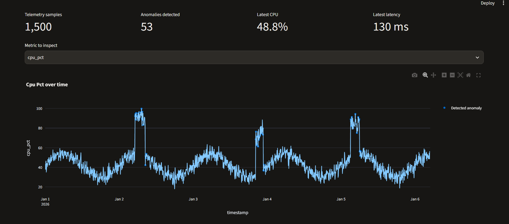
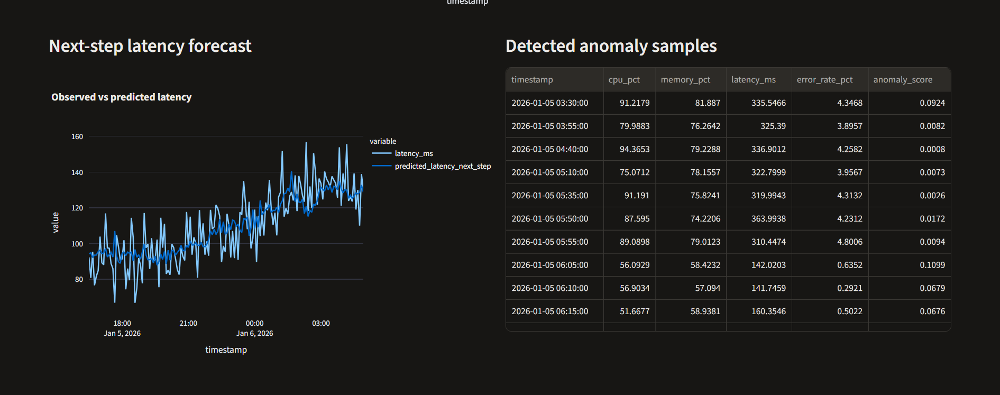
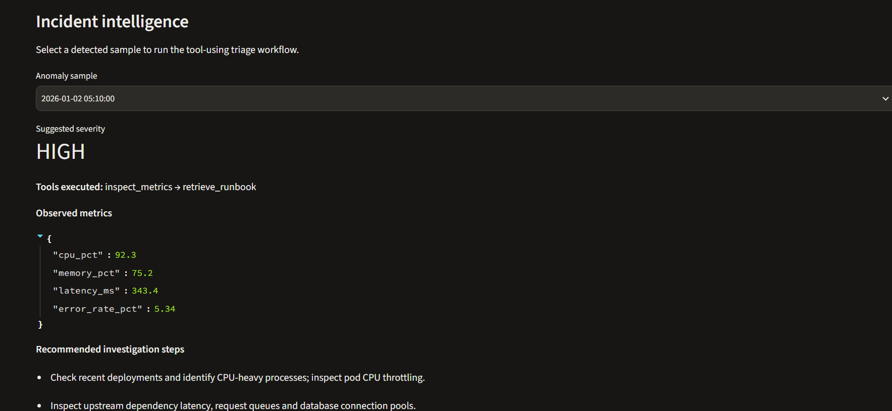
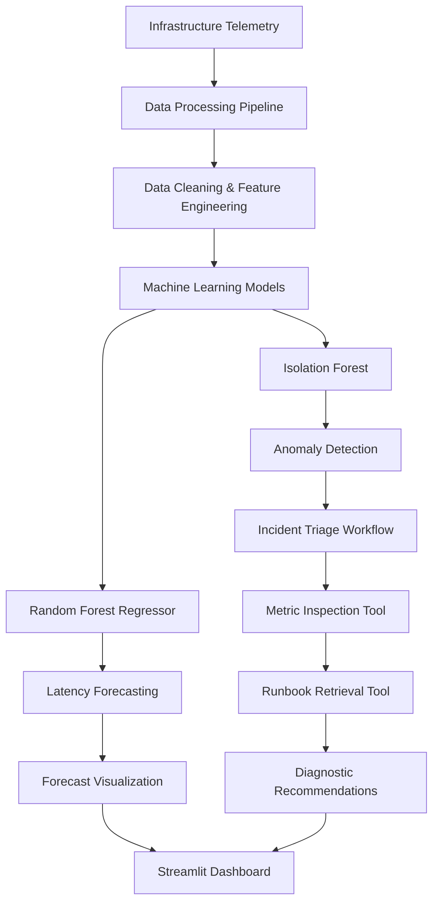

# 📡 OpsPulse — AI-Powered Infrastructure Anomaly Detection & Incident Intelligence

<p align="center">
  <strong>Detect infrastructure anomalies. Forecast performance degradation. Investigate incidents intelligently.</strong>
</p>

<p align="center">
  
  
  
  
  
  
</p>

---

## 🚀 Overview

**OpsPulse** is an AI-powered infrastructure monitoring and incident intelligence application designed to identify unusual system behaviour, forecast performance trends, and assist with infrastructure incident investigation.

The application processes infrastructure telemetry, including CPU utilization, memory consumption, API latency, and error rates. It applies machine learning techniques to detect anomalies and predict next-step latency, while a tool-using incident triage workflow provides contextual diagnostic recommendations.

Built using Python and Scikit-learn, OpsPulse demonstrates an end-to-end AI engineering workflow spanning data processing, time-series feature engineering, model training, evaluation, interactive visualization, and containerization.

## 📸 Dashboard Preview

### Infrastructure Monitoring Dashboard



### Time-Series Forecasting & Anomaly Detection



### AI-Assisted Incident Intelligence



## 🎯 Problem Statement

Infrastructure performance issues can develop through unusual resource utilization, increasing response times, and rising application error rates.

OpsPulse addresses this problem through:

- Monitoring infrastructure performance metrics.
- Identifying unusual patterns using unsupervised machine learning.
- Forecasting upcoming latency using historical telemetry.
- Investigating detected anomalies through a rule-based tool-using workflow.
- Providing actionable diagnostic recommendations through an interactive dashboard.

## ✨ Key Features

### 1. Infrastructure Telemetry Pipeline
- Generates reproducible infrastructure telemetry datasets.
- Processes CPU, memory, latency, and error-rate metrics.
- Handles missing values, duplicate timestamps, and data ordering.
- Performs rolling-window feature engineering and metric transformations.

### 2. Time-Series Anomaly Detection
- Implements **Isolation Forest**, an unsupervised machine learning algorithm.
- Identifies unusual infrastructure performance patterns.
- Uses current metrics and rolling statistical features.
- Produces anomaly scores for further investigation.

### 3. Latency Forecasting
- Implements a **Random Forest Regressor**.
- Predicts latency for the next five-minute sampling interval.
- Uses historical infrastructure metrics and engineered features.
- Evaluates forecasting performance using Mean Absolute Error (MAE).

### 4. Incident Intelligence & Tool-Using Workflow
- Inspects infrastructure metrics associated with detected anomalies.
- Executes metric inspection and runbook retrieval tools.
- Assigns suggested incident severity.
- Generates diagnostic recommendations based on metric thresholds.

### 5. Interactive Monitoring Dashboard
- Built using Streamlit and Plotly.
- Displays infrastructure performance metrics.
- Visualizes detected anomalies.
- Compares observed and predicted latency.
- Provides incident investigation recommendations.

### 6. MLOps & DevOps Foundations
- Saves trained models using Joblib.
- Provides a repeatable model training pipeline.
- Includes automated tests using Pytest.
- Uses GitHub Actions for continuous integration.
- Supports Docker-based application deployment.

## 🏗️ System Architecture



## 🧠 Machine Learning Methodology

| Component | Algorithm / Technique | Purpose |
|---|---|---|
| Anomaly Detection | Isolation Forest | Identify unusual infrastructure behaviour |
| Forecasting | Random Forest Regression | Predict next-step latency |
| Feature Engineering | Rolling Mean, Rolling Standard Deviation, Metric Delta | Capture temporal patterns |
| Model Evaluation | Mean Absolute Error (MAE) | Measure forecasting error |

### Model Evaluation

The forecasting model is evaluated using a chronological train-test split to preserve temporal ordering.

The evaluation metric used is Mean Absolute Error:

**MAE = Mean Absolute Error between actual and predicted latency**

A representative local training run produced:

| Evaluation Metric | Result |
|---|---:|
| Telemetry samples processed | 1,500 |
| Detected anomalies | 53 |
| Forecasting MAE | 10.74 ms |
| Engineered features | 16 |

*Note: These are results from the local synthetic-data demonstration run. Results may vary if the dataset, random seed, or model configuration changes. Anomaly flags are model predictions, not verified production incidents.*

## 🛠️ Tech Stack

| Category | Technologies |
|---|---|
| Programming Language | Python |
| Data Processing | Pandas, NumPy |
| Machine Learning | Scikit-learn |
| Algorithms | Isolation Forest, Random Forest |
| Model Persistence | Joblib |
| Dashboard | Streamlit |
| Visualization | Plotly |
| Testing | Pytest |
| Containerization | Docker |
| Version Control | Git, GitHub |
| CI/CD | GitHub Actions |

## 📁 Project Structure

```text
opspulse/
│
├── .github/
│   └── workflows/
│       └── ci.yml
│
├── data/
│
├── models/
│
├── src/
│   ├── __init__.py
│   ├── data_pipeline.py
│   ├── model.py
│   └── triage_agent.py
│
├── tests/
│   └── test_pipeline.py
│
├── app.py
├── pipeline.py
├── requirements.txt
├── Dockerfile
├── .gitignore
└── README.md
```

## ⚙️ Installation & Setup

### Prerequisites

- Python 3.10 or later (Python 3.11 recommended).
- Git.
- VS Code or another Python-compatible IDE.

### 1. Clone the Repository

```bash
git clone https://github.com/AnannaB/opspulse-ai-infrastructure-monitoring.git
```

Navigate into the project directory:

```bash
cd opspulse-ai-infrastructure-monitoring
```

### 2. Create a Virtual Environment

**Windows PowerShell:**

```powershell
python -m venv venv
```

Activate it:

```powershell
.\venv\Scripts\Activate.ps1
```

### 3. Install Dependencies

```bash
python -m pip install --upgrade pip
pip install -r requirements.txt
```

### 4. Run the Training Pipeline

```bash
python pipeline.py
```

This generates the synthetic telemetry dataset, performs feature engineering, trains the anomaly detection and forecasting models, and saves the model artifacts.

### 5. Launch the Dashboard

```bash
streamlit run app.py
```

Open the application at:

```text
http://localhost:8501
```

## 🐳 Docker Deployment

Build the Docker image:

```bash
docker build -t opspulse .
```

Run the container:

```bash
docker run -p 8501:8501 opspulse
```

Access the dashboard at:

```text
http://localhost:8501
```

## 🧪 Testing

Run the automated test suite:

```bash
python -m pytest -q
```

The tests cover:

- Data processing and feature engineering.
- Incident triage tool execution.
- Machine learning model training.

GitHub Actions automatically executes the test suite and training pipeline on repository pushes and pull requests.

## 🔍 Current Scope & Limitations

- Uses synthetic infrastructure telemetry with deliberately injected anomalies for demonstration.
- Anomaly detection is unsupervised and does not use verified incident labels.
- Forecasting is limited to one five-minute step ahead.
- Incident triage uses deterministic Python tools and threshold-based recommendations, not an autonomous LLM agent.
- The application demonstrates a prototype workflow rather than a production monitoring system.
- No live Kubernetes or Prometheus integration is currently implemented.

## 🔮 Future Improvements

- Integrate live infrastructure metrics using Prometheus.
- Extend monitoring to Kubernetes workloads.
- Introduce MLflow for experiment tracking and model versioning.
- Implement model drift monitoring and scheduled retraining.
- Develop an LLM-powered incident investigation agent with constrained tool access.
- Add REST API-based model serving using FastAPI.
- Introduce alert notifications and human-approved remediation workflows.

## 👩‍💻 Author

**Ananna Basak**

B.Tech – Computer Science and Engineering

- GitHub: [@AnannaB](https://github.com/AnannaB)
- LinkedIn: [Ananna Basak](https://www.linkedin.com/in/ananna-basak/)

---

<p align="center">
  <strong>OpsPulse — Turning infrastructure telemetry into actionable intelligence.</strong>
</p>